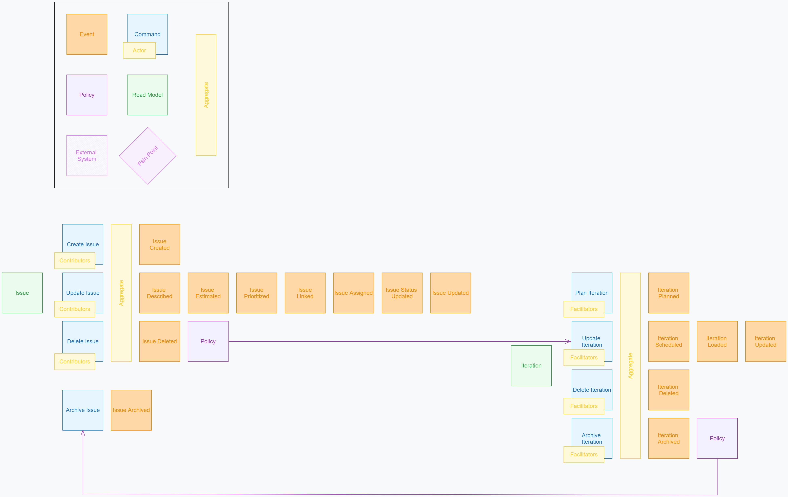

# Domain model

## Event storm

The first analysis was an event-storming session, preserved here:



Legend: orange = event, blue = command, yellow (small) = actor, yellow (tall) =
aggregate, purple = policy, green = read model, pink = external system or pain
point.

### What the storm contains

**Issue aggregate** — actor: *Contributors*

| Command | Events |
|---------|--------|
| Create Issue | Issue Created |
| Update Issue | Issue Described, Issue Estimated, Issue Prioritized, Issue Linked, Issue Assigned, Issue Status Updated, Issue Updated |
| Delete Issue | Issue Deleted |
| Archive Issue | Issue Archived |

**Iteration aggregate** — actor: *Facilitators*

| Command | Events |
|---------|--------|
| Plan Iteration | Iteration Planned |
| Update Iteration | Iteration Scheduled, Iteration Loaded, Iteration Updated |
| Delete Iteration | Iteration Deleted |
| Archive Iteration | Iteration Archived |

**Policies**

1. *Issue Deleted* → **Update Iteration**: removing an issue removes it from
   its iteration's scope.
2. *Iteration Archived* → **Archive Issue**: archiving an iteration archives
   its issues. Since the design sessions this is configurable — see
   [Iteration completion policy](#iteration-completion-policy).

**Read models**: *Issue*, *Iteration*.

### How the storm maps to the implementation

The storm's coarse commands (*Update Issue*) become fine-grained API operations
in the implementation, each emitting the specific event the storm already
names. *Issue Updated* covers changes that don't have a dedicated event (title,
labels, dates, custom fields).

Persistence is **not** event-sourced: aggregates are stored as rows, and every
change also appends a domain event in the same transaction. See
[ADR-0004](adr/0004-state-tables-with-domain-event-log.md).

## Glossary

| Term | Meaning |
|------|---------|
| **Instance** | One deployment: binary + PostgreSQL + NATS + object storage |
| **Workspace** | Top-level container inside an instance; holds projects, teams, members and the default configuration |
| **Project** | Owns issues, iterations, releases and milestones. Has a unique **key** (`HZN`) used in issue keys (`HZN-42`) |
| **Team** | A named group of users, used to grant roles. Teams do not own work |
| **Member** | A user's membership in a workspace |
| **Role** | A named, configurable set of permissions, granted to users or teams at workspace or project scope |
| **Contributor** / **Facilitator** | Default roles from the storm: contributors work on issues, facilitators run iterations |
| **Issue** | The unit of work. Has a type, a status, and an optional parent |
| **Issue type** | Configurable kind of issue (Epic, Story, Bug, …), with an icon, colour, workflow and fields |
| **Workflow** | A state machine of statuses and allowed transitions, bound to an issue type |
| **Status** | A state in a workflow. Each status belongs to one **status category** |
| **Status category** | Configurable grouping of statuses (workspace default, project override). Each has an **outcome**. Built-in: Backlog, Todo (unstarted), In progress (started), Done (completed), Canceled (abandoned) |
| **Outcome** | Fixed property of a category — `unstarted`, `started` (both *open*), `completed`, `abandoned` (both *final*). What cross-project features (reports, iteration completion, Git automation) rely on |
| **Iteration** | A time-boxed sprint within a project |
| **Release** | A version issues are targeted to (Jira's *fix version*) |
| **Milestone** | A dated point on the timeline, at project or workspace level |
| **View** | A saved combination of layout (list, board, table, timeline, calendar), filters, grouping, sorting and display options |
| **Rank** | Manual ordering of issues within the backlog or a board column |
| **Tombstone** | The only trace kept of a hard-deleted aggregate |

## Aggregates

Each aggregate is a consistency boundary: one transaction changes one
aggregate. Cross-aggregate reactions go through policies driven by domain
events.

### Workspace
Name, slug, settings, default configuration (types, workflows, fields, scales,
policies), members, teams, roles.

### Project
Key, name, description, lead, visibility, configuration overrides, issue
sequence counter.

**Invariants**
- The key is unique within the workspace, 2–10 uppercase letters or digits,
  starting with a letter.
- Renaming the key keeps old keys as aliases, so `OLD-12` still resolves. No
  other project can take a current or former key; a project can take one of
  its own former keys back.
- Archiving makes a project read-only and hides it from the sidebar; it can
  be restored. Only an archived project can be deleted
  (see [Deletion](#deletion)).

### Issue
| Field | Notes |
|-------|-------|
| `key` | `<PROJECT>-<n>`, `n` from the project's sequence, never reused |
| `type` | Issue type, resolved from workspace/project configuration |
| `title` | Required |
| `description` | Block document (see [realtime.md](realtime.md)); plain text until phase 5 |
| `status` | Must be a status of the type's workflow |
| `priority` | `none`, `urgent`, `high`, `medium`, `low` |
| `rank` | Fractional index string for manual ordering |
| `estimate` | A value from the project's estimation scale, or empty |
| `assignee` | One user, or none |
| `parent` | Another issue in the same workspace, or none |
| `iteration` | Iteration of the same project, or none |
| `release` | Release of the same project, or none |
| `labels` | Workspace or project labels |
| `start_date`, `due_date` | Used by the timeline and calendar |
| `fields` | Custom field values, by field id |
| `archived_at` | Set when archived; archived issues are read-only |

**Invariants**
- The parent chain has no cycles.
- A status change must follow an allowed transition of the type's workflow,
  and satisfy its conditions (see [configuration.md](configuration.md#workflows)).
- Changing the type requires mapping the current status into the new type's
  workflow.
- Archived issues accept only *Unarchive* and *Delete*.
- The type's parent rule holds: Epics take no parent, Sub-tasks need one of
  the allowed parent types; required custom fields of the type are set at
  creation.

**Moving to another project**
- Type, status, labels and custom fields are matched by name in the target
  project's resolved configuration; the user maps what doesn't match, or
  accepts that unmapped values are dropped (listed before confirming).
- Iteration and release are cleared; links, comments, attachments and history
  are kept.
- The issue gets a new key from the target project's sequence; the old key
  becomes an **alias** and keeps resolving.
- If the issue has children, the user chooses: move the subtree (same mapping
  applied to every descendant) or leave the children where they are (their
  parent is then in another project, which is allowed).
- Requires `issue.move` on the source project and `issue.create` on the
  target.

**Events** (in addition to those in the storm): `IssueUnarchived`,
`IssueMoved` (to another project), `IssueParentChanged`, `IssueUnlinked`,
`IssueRanked`, `IssueIterationChanged`, `IssueReleaseChanged`,
`IssueCommented`, `IssueCommentEdited`, `IssueCommentDeleted`,
`IssueAttachmentAdded`, `IssueAttachmentRemoved`. Comment and attachment
events carry their ids, never their content.

**Comments** are plain text until block documents (phase 5). Authors edit
and delete their own; `issue.comment.moderate` deletes anyone's. Archived
issues take no new comments or attachments. **Attachments** are at most
100 MiB; the uploader or a moderator removes them.

### Link
Stored with its source issue, typed:

| Type | Inverse | Scheduling |
|------|---------|------------|
| `relates_to` | `relates_to` | — |
| `blocks` | `blocked_by` | — |
| `duplicates` | `duplicated_by` | — |
| `precedes` | `follows` | Yes. Optional lag in working days; drives auto-scheduling on the timeline ([working calendar](configuration.md#time-zone-and-working-calendar)) |

Parent/child is not a link; it is the `parent` field.

### Iteration
Name, goal, start and end dates, state, and the set of issues it holds.

```
planned ──schedule──▶ scheduled ──start──▶ active ──complete──▶ completed ──archive──▶ archived
```

| Event | Meaning |
|-------|---------|
| `IterationPlanned` | Created (storm) |
| `IterationScheduled` | Dates set or changed (storm) |
| `IterationLoaded` | Issues added or removed (storm) |
| `IterationUpdated` | Name or goal changed (storm) |
| `IterationStarted` | Became active *(new)* |
| `IterationCompleted` | Closed; completion policy applied *(new)* |
| `IterationArchived` | Hidden from active planning (storm) |
| `IterationDeleted` | Hard deleted (storm) |

**Invariants**
- Dates are required to start.
- At most `max_active_iterations` active per project (configurable, default 1).
- Only issues of the same project can be loaded.

### Release
Name, description, start and release dates, state (`unreleased`, `released`,
`archived`). Events: `ReleaseCreated`, `ReleaseUpdated`, `ReleaseReleased`,
`ReleaseArchived`, `ReleaseDeleted`.

### Milestone
Name, date, optional project (none means workspace-level), linked issues.
Events: `MilestoneCreated`, `MilestoneUpdated`, `MilestoneDeleted`.

### View
Owner, scope (personal, project or workspace), layout, filter tree, grouping,
sorting, display options.

### Configuration aggregates
Issue types, workflows, custom fields, estimation scales, labels and policy
settings are aggregates too: changing them emits events
(`WorkflowDraftSaved`, `WorkflowPublished`, …), so caches and connected clients refresh.

## Policies

| When | Then | Notes |
|------|------|-------|
| `IssueDeleted` | Remove the issue from its iteration's scope (`IterationLoaded`) | Storm policy 1 |
| `IterationCompleted` | Apply the completion policy | Storm policy 2, generalised |
| `IssueDeleted` | Delete its links, comments, attachments; handle children as chosen | See [Deletion](#deletion) |
| Git PR merged referencing an issue | Transition to the configured status, if allowed | Configurable per project |
| `IssueAssigned`, `IssueCommented` with @mention, any change to a subscribed issue | Notify | See notifications in [architecture.md](architecture.md#workers) |
| Any domain event | Fan out to WebSocket clients and matching webhooks | |

### Iteration completion policy

Configurable at workspace level, overridable per project
([configuration.md](configuration.md)):

| Mode | On completion |
|------|---------------|
| `archive_all` | Every issue in the iteration is archived. The storm's original reading |
| `archive_done_rollover_rest` *(default)* | Issues in a final category (outcome `completed` or `abandoned`) are archived; others move to the next iteration or to the backlog, chosen by the facilitator when closing |
| `none` | Nothing changes; issues stay in the completed iteration |

## Deletion

Delete is a **hard delete** (see [ADR-0012](adr/0012-hard-delete-with-event-scrubbing.md)):

1. If the issue has children, the user chooses at delete time (the API
   requires `children=reparent|cascade` and refuses the delete otherwise):
   - `reparent` — children move to the deleted issue's parent (or become
     top-level);
   - `cascade` — the whole subtree is deleted, each descendant with its own
     tombstone. Requires `issue.delete` on every descendant; the confirmation
     dialog lists them.
2. The aggregate row and everything it owns (comments, attachments in object
   storage, editor history, links, notifications, webhook delivery logs,
   search entries) is removed.
3. Every stored domain event of that aggregate is removed, from PostgreSQL
   **and** from the JetStream stream.
4. A single **tombstone** event is written: `IssueDeleted` with id, key, actor
   and timestamp only — no content.

Archive is the non-destructive alternative: archived items are read-only,
hidden from active views by default, and still searchable.

**Deleting a project** is the same hard delete applied to all its issues:
only an **archived** project can be deleted, with `project.manage`, typing
its key to confirm. Its issues and their content are removed as above, its
configuration overrides and grants with it, and one tombstone event
(`ProjectDeleted`: id, key, actor, time) remains. Its key becomes free.
